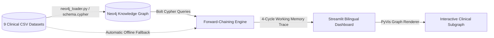
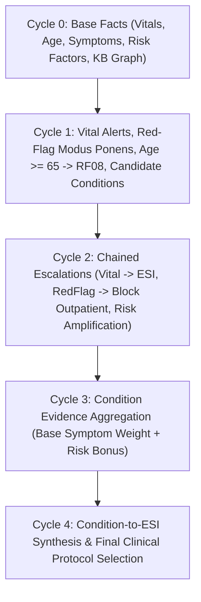

# Medical Triage & Emergency Priority Knowledge System (IS438)

Knowledge-Based Clinical Triage System built with **Neo4j Knowledge Graphs**, a **Multi-Cycle Forward-Chaining & Modus Ponens Inference Engine** in Python, and a bilingual (`EN` / `AR` BiDi-safe) **Streamlit** clinical decision dashboard. Classifies incoming patient cases into 5 **Emergency Severity Index (`ESI-1` to `ESI-5`)** tiers, detects physiological red flags, maps differential conditions, and enforces safety contraindications with full explainability.

[](https://github.com/Mahmoud-Megahed1/Medical-Triage-KBS)
[](https://www.python.org/)
[](https://neo4j.com/)
[](src/inference_engine.py)
[](src/app.py)

---

## Architecture & System Context



### Technology Matrix

| Layer / Concern | Technology | Architectural Responsibility |
| :--- | :--- | :--- |
| **Knowledge Graph** | Neo4j (`Cypher` / `Bolt`) | Stores patients, symptoms, conditions, risk factors, and clinical protocols |
| **Seed & ETL Pipeline** | `neo4j_loader.py` + `schema.cypher` | Imports all 9 normalized CSV files idempotently via `MERGE` constraints |
| **Inference Engine** | Python (`WorkingMemory` + `ProductionRule`) | Executes multi-cycle Forward Chaining & Modus Ponens until fixed-point saturation |
| **Dual-Mode Resilience** | `MedicalTriageEngine` | Runs live Cypher traversals on Neo4j (`LIVE_NEO4J`) or falls back to local CSV (`LOCAL_GRAPH`) |
| **Clinical Interface** | Streamlit + PyVis | Displays ESI disposition, differential diagnosis, protocols, rule trace, and live simulator |
| **Verification** | Python `unittest` | 11 automated tests validating ESI-1 through ESI-5, vital alerts, and multi-cycle saturation |

---

## Knowledge Graph Ontology & Schema

The graph schema models clinical triage relationships rather than isolated tables:

- **Patient Context:** `:Patient` linked via `[:PRESENTS_SYMPTOM]` to `:Symptom` and via `[:HAS_RISK_FACTOR]` to `:RiskFactor`.
- **Diagnostic Graph:** `:MedicalCondition` linked via `[:INDICATED_BY {role, weight}]` to `:Symptom` (`RED_FLAG_TRIGGER`, `PRIMARY_INDICATOR`, `SUPPORTING`).
- **Comorbidity Escalation:** `:RiskFactor` linked via `[:ESCALATES_RISK_OF {escalation_points, clinical_rationale}]` to `:MedicalCondition`.
- **Safety & Protocols:** `:MedicalCondition` linked via `[:REQUIRES_PROTOCOL]` to `:ClinicalProtocol` (`IMMEDIATE_INTERVENTION`, `DIAGNOSTIC_WORKUP`, `CONTRAINDICATION`).

---

## Multi-Cycle Inference Engine & Triage Tiers

The reasoning engine seeds a `WorkingMemory` fact base and executes declarative `ProductionRule` passes synchronously across cycles until zero new facts are inferred:



### Supported Emergency Severity Index (`ESI`) Tiers

| Triage Tier | Urgency Level | Max Wait | Clinical Disposition |
| :--- | :--- | :--- | :--- |
| `ESI-1` | Immediate Resuscitation | `0 min` | Immediate life-saving intervention in Resuscitation Bay |
| `ESI-2` | Emergent Priority | `<= 10 min` | High-risk emergency care (Red-Flag / Vital instability) |
| `ESI-3` | Urgent Evaluation | `<= 30 min` | Priority ED evaluation and diagnostic imaging/labs |
| `ESI-4` | Less Urgent Standard | `<= 60 min` | ER Fast Track or standard urgent care |
| `ESI-5` | Non-Urgent Outpatient | `<= 120 min` | Routine outpatient clinic consultation |

---

## Getting Started

### Prerequisites

- Python `3.11+`
- Optional for live graph mode: Neo4j Desktop or Neo4j Server listening on `bolt://localhost:7687`

### Local Setup & Execution

1. Clone the repository:
```bash
git clone https://github.com/Mahmoud-Megahed1/Medical-Triage-KBS.git
cd Medical-Triage-KBS
```

2. Install dependencies:
```bash
pip install -r requirements.txt
```

3. *(Optional)* Seed Neo4j from CSV:
Start your Neo4j instance (default URI `bolt://localhost:7687`, user `neo4j`, password `password123`) and run:
```bash
python src/neo4j_loader.py
```
Alternatively, copy the files from `data/` into Neo4j's `import/` directory and execute `cypher/schema.cypher`, then inspect sample traversals in `cypher/queries.cypher`. If Neo4j is not running, the engine operates seamlessly in `LOCAL_GRAPH` mode.

4. Run the automated test suite:
```bash
python -m unittest discover -s tests -v
```

5. Launch the clinical dashboard:
```bash
streamlit run src/app.py
```
Or on Windows, double-click `run_app.bat`.

---

## Project Structure

```text
Medical-Triage-KBS/
├── .streamlit/
│   └── config.toml                Light-mode Streamlit theme configuration
├── cypher/
│   ├── schema.cypher              Neo4j constraints, indexes, and LOAD CSV import script
│   └── queries.cypher             Demonstrative Cypher traversal & reasoning queries
├── data/
│   ├── action_protocols.csv       Interventions, diagnostic workups, and contraindications
│   ├── condition_symptoms.csv     Weighted symptom-to-condition indicator edges
│   ├── conditions.csv             13 clinical conditions mapped to ESI-1..ESI-5 tiers
│   ├── patient_risk_factors.csv   Active patient comorbidity links
│   ├── patient_symptoms.csv       Reported patient symptom links
│   ├── patients.csv               7 sample patient records with recorded vital signs
│   ├── risk_condition_links.csv   Comorbidity escalation scores and clinical rationales
│   ├── risk_factors.csv           8 baseline risk factors (Hypertension, Diabetes, Age >= 65, etc.)
│   └── symptoms.csv               24 symptoms tagged by body system and Red-Flag status
├── src/
│   ├── app.py                     Bilingual Light-Mode Streamlit UI + PyVis knowledge graph
│   ├── inference_engine.py        Dual-mode Forward-Chaining & Modus Ponens inference engine
│   └── neo4j_loader.py            Automated Python CSV-to-Neo4j Bolt loader
├── tests/
│   └── test_inference_engine.py   11 unit tests covering ESI tiers, vitals, and multi-cycle chaining
├── .gitignore
├── README.md
├── requirements.txt
└── run_app.bat
```

---

## Team & Academic Supervision

- **Course:** New Trends in Information Systems (`IS438`) — Faculty of Computers & Artificial Intelligence, Damietta University
- **Supervised by:** Dr. Aya Gamal & Eng. Amal
- **Contributors:**
  - [Mahmoud Megahed](https://github.com/Mahmoud-Megahed1)
  - [Kareem Elsandarosy](https://github.com/KareemElsandarosy)
